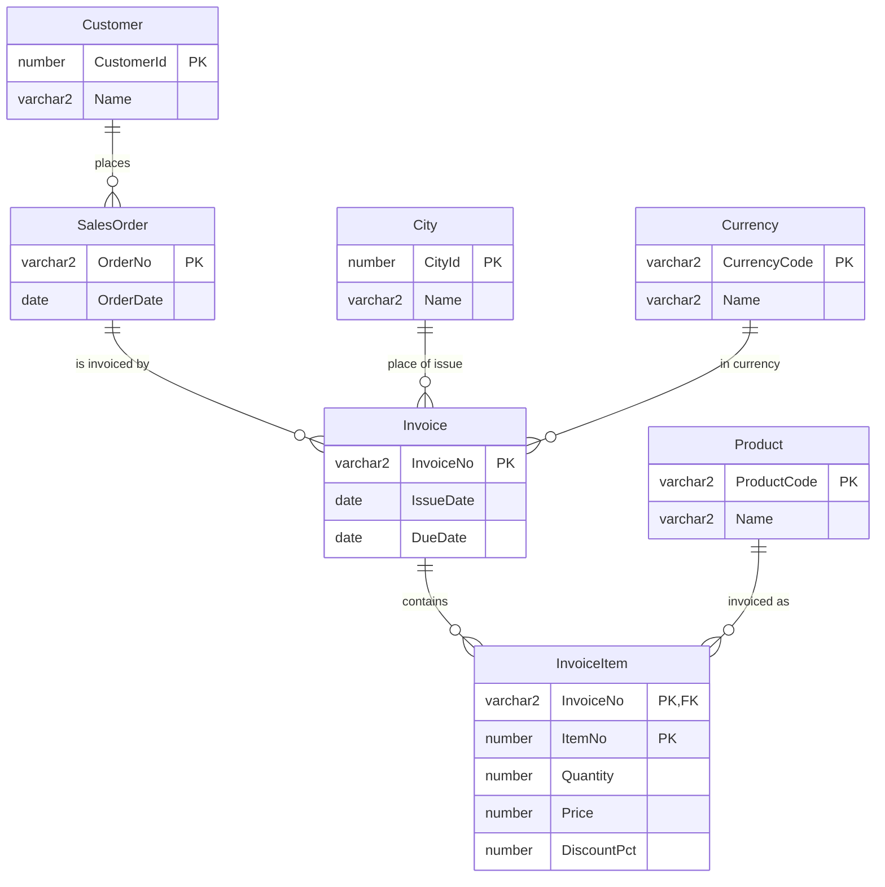

# Conceptual model: document "Invoice"

Conceptual diagram of one business document: only the entities the invoice touches. The invoice is issued for a sales order (see [Sales order](01_document_sales_order.md)); the customer is reached through the order.

## Legend

- `||--o{` : one-to-many (exactly one on the left, zero or many on the right).
- `InvoiceItem` is a weak entity: its key is (InvoiceNo, ItemNo).
- The path Invoice -> SalesOrder -> Customer is the two-level dependency that part 2 shortcuts with redundant columns ([03_relational_part2.md](03_relational_part2.md)).
