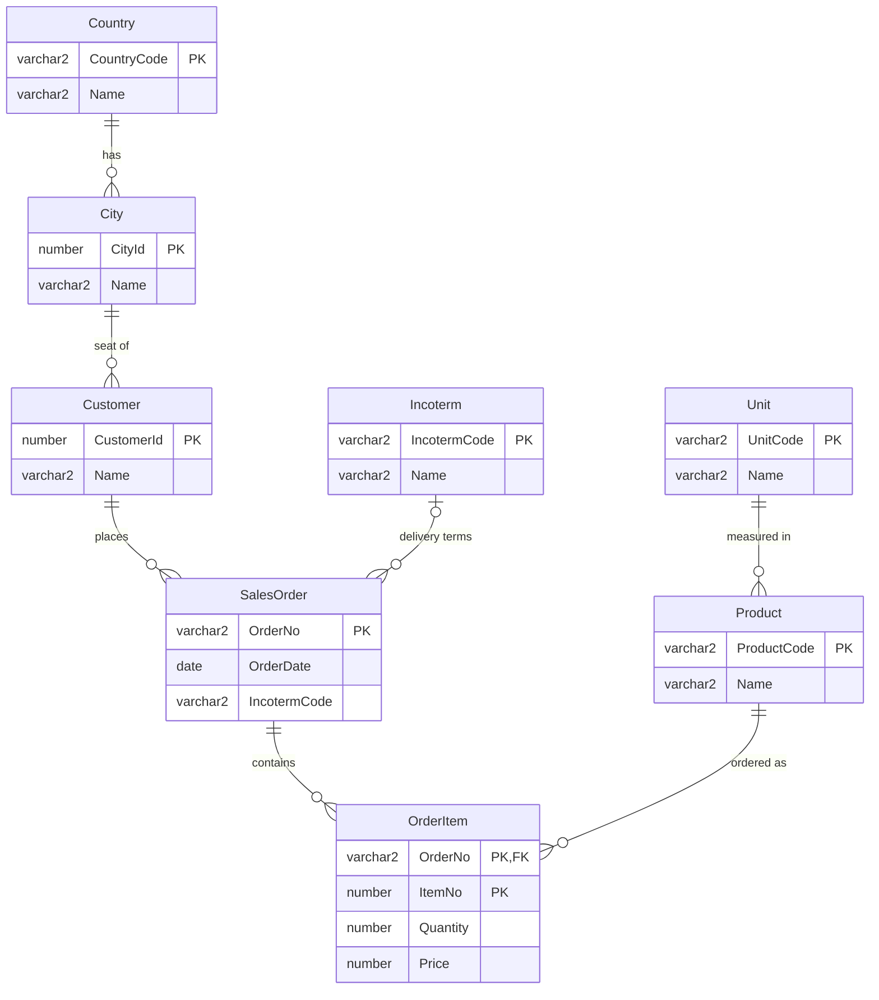

# Conceptual model: document "Sales order"

Conceptual diagram of one business document: only the entities the sales order touches. Attributes are the business-relevant ones; technical details (types, constraints) are in [02_relational_part1.md](02_relational_part1.md).

## Legend

- `||--o{` : one-to-many (exactly one on the left, zero or many on the right).
- `|o--o{` : the left side is optional (an order may have no incoterm).
- `OrderItem` is a weak entity: its key is (OrderNo, ItemNo).
- `Incoterm` exists as a table only in parts 1 and 2; in part 3 it becomes a CHECK constraint ([04_relational_part3.md](04_relational_part3.md)).
- Next document: [Invoice](01_document_invoice.md).
