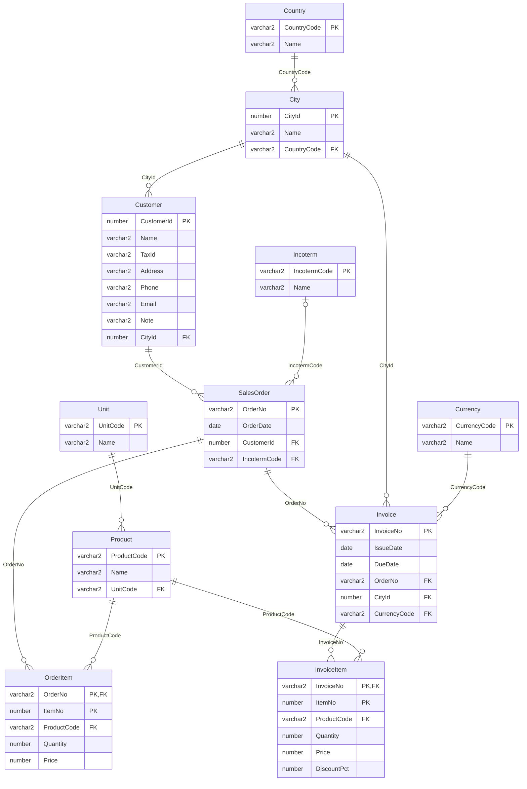

# Relational model after part 1 (normalized)

Source: [queries/01_tables.sql](../queries/01_tables.sql). Explanation: [explanations/01_database_design.md](../explanations/01_database_design.md). Assignment: [assignments/01_database_design.md](../assignments/01_database_design.md).

## Compact notation

PK = primary key, FK->Target = foreign key. Composite keys are in the PK list.

| Table | Columns |
|---|---|
| Country | Country(**CountryCode**, Name) |
| City | City(**CityId**, Name, CountryCode FK->Country) |
| Unit | Unit(**UnitCode**, Name) |
| Currency | Currency(**CurrencyCode**, Name) |
| Incoterm | Incoterm(**IncotermCode**, Name) |
| Customer | Customer(**CustomerId**, Name, TaxId, Address, Phone, Email, Note, CityId FK->City) |
| Product | Product(**ProductCode**, Name, UnitCode FK->Unit) |
| SalesOrder | SalesOrder(**OrderNo**, OrderDate, CustomerId FK->Customer, IncotermCode FK->Incoterm) |
| OrderItem | OrderItem(**OrderNo FK->SalesOrder, ItemNo**, ProductCode FK->Product, Quantity, Price) |
| Invoice | Invoice(**InvoiceNo**, IssueDate, DueDate, OrderNo FK->SalesOrder, CityId FK->City, CurrencyCode FK->Currency) |
| InvoiceItem | InvoiceItem(**InvoiceNo FK->Invoice, ItemNo**, ProductCode FK->Product, Quantity, Price, DiscountPct) |

Check constraints: Quantity > 0 and Price > 0 (OrderItem, InvoiceItem), DiscountPct BETWEEN 0 AND 100.
Optional (nullable) columns: Customer.TaxId, Address, Phone, Email, Note; SalesOrder.IncotermCode; Incoterm.Name.
