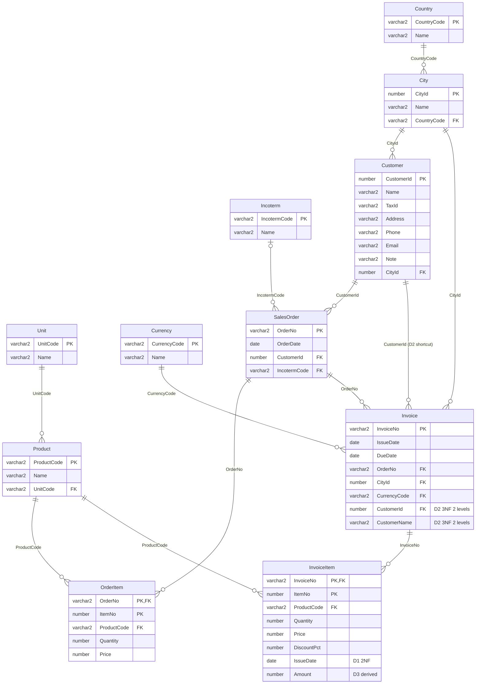

# Relational model after part 2 (denormalization)

Source: [queries/03_denormalization.sql](../queries/03_denormalization.sql), [queries/04_triggers.sql](../queries/04_triggers.sql). Explanation: [explanations/02_denormalization.md](../explanations/02_denormalization.md). Assignment: [assignments/02_denormalization.md](../assignments/02_denormalization.md).

Same model as [part 1](02_relational_part1.md) plus redundant columns, marked in the diagram by a comment: `D1 2NF`, `D2 3NF 2 levels`, `D3 derived`. New foreign key: fk_inv_customer (Invoice.CustomerId -> Customer).

## Redundant columns and the triggers that keep them consistent

| Label | Normal form | Column | Source of the value | Trigger(s) |
|---|---|---|---|---|
| D1 | 2NF | InvoiceItem.IssueDate | Invoice.IssueDate | `trg_invoiceitem_date` (T1: fills on insert / invoice change, forbids manual change); `trg_invoice_date_items` (T2: cascades a changed Invoice.IssueDate to the items) |
| D2 | 3NF, 2 levels (Invoice -> SalesOrder -> Customer) | Invoice.CustomerId, Invoice.CustomerName | Customer.CustomerId, Customer.Name via SalesOrder | `trg_invoice_customer` (T3: fills on insert / order change, forbids manual change); `trg_customer_invoice` (T4: cascades a renamed Customer.Name to the invoices of its orders) |
| D3 | 3NF, derived attribute | InvoiceItem.Amount | ROUND(Quantity * Price * (1 - NVL(DiscountPct, 0) / 100), 2) | `trg_invoiceitem_amount` (T5: always recomputed) |

Support: package `pkg_denorm` holds the flag `g_cascade`, TRUE while T2 or T4 changes the copies, so T1 and T3 let the cascade through.
