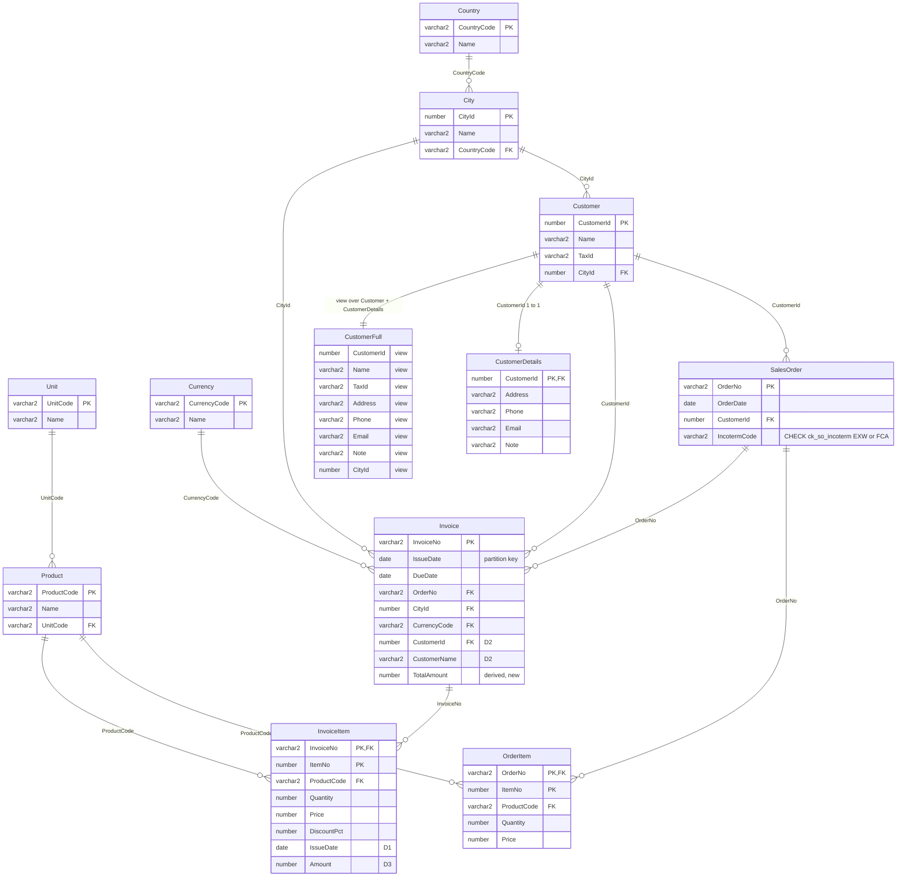

# Relational model after part 3 (optimization)

Source: [queries/06_logical_optimization.sql](../queries/06_logical_optimization.sql), [queries/10_partitioning.sql](../queries/10_partitioning.sql). Explanation: [explanations/03_optimization.md](../explanations/03_optimization.md). Assignment: [assignments/03_optimization.md](../assignments/03_optimization.md).

Changes relative to [part 2](03_relational_part2.md):

1. Invoice.TotalAmount added (stored derived value, technique 1).
2. Table Incoterm removed; SalesOrder.IncotermCode is protected by CHECK `ck_so_incoterm` (technique 2, hard-coded values).
3. Customer split vertically: Address, Phone, Email, Note moved to CustomerDetails (1:1); view `CustomerFull` restores the original column set.
4. Invoice horizontally partitioned by month (physical change, not visible as columns).

## Notes

- **Invoice partitioning**: `PARTITION BY RANGE (IssueDate) INTERVAL (NUMTOYMINTERVAL(1, 'MONTH'))` with the initial empty partition `p_before_2024`; Oracle creates one partition per month automatically. `pk_invoice` stays a global index.
- **CustomerDetails**: PK is also FK (`fk_cd_customer`, ON DELETE CASCADE), which makes the relationship 1:1. Writes through `CustomerFull` are handled by INSTEAD OF triggers `trg_customerfull_ins`, `trg_customerfull_upd`, `trg_customerfull_del`.
- **TotalAmount**: kept by `trg_invoiceitem_total` (compound trigger on InvoiceItem), guarded against manual change by `trg_invoice_total_guard`.
- **Incoterm values** before removal: EXW = Ex Works, FCA = Free Carrier. The procedure `p_change_incoterms` rewrites the CHECK.

## Before / after for the changed tables

| Table | Before (part 2) | After (part 3) |
|---|---|---|
| Incoterm | Incoterm(**IncotermCode**, Name) | removed (DROP TABLE) |
| SalesOrder | IncotermCode FK->Incoterm (fk_so_incoterm) | IncotermCode with CHECK ck_so_incoterm IN ('EXW','FCA'), no FK |
| Invoice | no TotalAmount; ordinary table | + TotalAmount NUMBER(16,2) DEFAULT 0 NOT NULL; partitioned by month on IssueDate |
| Customer | CustomerId, Name, TaxId, Address, Phone, Email, Note, CityId | CustomerId, Name, TaxId, CityId |
| CustomerDetails | does not exist | CustomerDetails(**CustomerId FK->Customer**, Address, Phone, Email, Note), 1:1 |
| CustomerFull | does not exist | view: Customer LEFT JOIN CustomerDetails, original column order |
