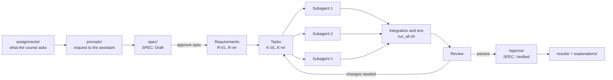

# Spec workflow: spec → requirements → tasks → subagents → review → approve

This document defines **how specs are written in this repository** and how one spec is turned into
working, tested code. It is the rulebook for every other file in `spec/`.

It applies whether the work is done by you alone, by one AI assistant, or by a coordinator that
delegates tasks to several parallel subagents.

---

## 1. The pipeline at a glance



| Stage | Input | Output | Who | Gate to the next stage |
|---|---|---|---|---|
| 0. Prompt | assignment text | `prompts/NN_*.md` | student | the prompt states the goal, files and constraints |
| 1. Spec | prompt + **existing code** | `spec/NN_*.md`, status `Draft` | coordinator | every open question is resolved or has a recommendation |
| 2. Requirements | spec | numbered list `R-xx` inside the spec | coordinator | each R is testable |
| 3. Tasks | requirements | task table `K-xx` inside the spec | coordinator | every R is covered by at least one K; file ownership does not overlap |
| 4. Subagents | one brief per task group | files + a short report | subagents (parallel) | each subagent reports what it wrote, tested and deviated from |
| 5. Integration and test | all files | `results/*.txt` | coordinator | the full run order passes, only expected errors appear |
| 6. Review | diff + results vs spec | review notes (findings) | coordinator / reviewer | no open findings of severity "must fix" |
| 7. Approve | review + results | spec status `Verified`, results report | **student (human)** | explicit "approved" from the human |

> Approval is always a human decision. An agent may report "all checks pass", but it never marks a spec approved on its own.

---

## 2. Spec rules

### 2.1 File and status

- File name: `spec/NN_<topic>.md`, where `NN` matches the prompt (`prompts/01_*.md` → `spec/01_*.md`).
- First lines of every spec:

  ```markdown
  # Spec: <part>, <topic>
  Status: Draft | Approved | Implemented | Verified
  Source: prompts/NN_<topic>.md
  Scripts: queries/NN_*.sql, ...
  ```

- Status lifecycle:

  | Status | Meaning | Set by |
  |---|---|---|
  | `Draft` | being written, may still change | coordinator |
  | `Approved` | the human accepted the plan; implementation may start | human |
  | `Implemented` | all tasks done, files exist | coordinator |
  | `Verified` | tests passed and the human approved the result | human |

### 2.2 Mandatory sections

Every spec has these sections, in this order. Omit a section only by writing "N/A" with a reason.

| # | Section | Contents |
|---|---|---|
| 0 | **Starting state and deviations** | What really exists in the code (tables, triggers, packages, data values). A table of every place where the prompt and the code disagree: *prompt says / actual state / decision*. |
| 1 | **Style** | Language, comment style, naming, error code range, terminators, re-runnability. |
| 2..n | **One section per deliverable file** | Exact object names, signatures, the order of steps, error codes and messages, and the edge cases. Short pseudo-code or SQL snippets are allowed; a full implementation is not. |
| n+1 | **Requirements** | `R-xx` list (see §3). |
| n+2 | **Tasks** | `K-xx` table (see §4). |
| n+3 | **Test plan** | Table: step / action / **exact expected result** (numbers, error codes). |
| n+4 | **Documentation content** | Tables and models that go into the final report (trigger table, relational model before/after, execution plans). |
| n+5 | **Acceptance checklist** | `- [ ]` items the reviewer ticks off. |
| n+6 | **Open questions** | Each one has options and a **recommendation**; it is closed by the human. |
| – | **Changelog** | `YYYY-MM-DD: what changed and why`. |

### 2.3 Writing rules

1. **Read the code before writing the spec.** Never trust the prompt's description of existing files. The deviation table (section 0) is where you record what you found.
2. **Be exact.** Use real object names, column types, error codes and message texts, and give expected numbers to two decimals. "Should work correctly" is not a requirement.
3. **Decide, don't survey.** When there are options, pick one and give the reason. Put the alternative in *Open questions* only if the choice is genuinely the human's.
4. **One source of truth.** If the implementation has to differ from the spec, update the spec first (and add a changelog line), then change the code.
5. **Name side effects.** Implicit commits (DDL), triggers that fire in cascade, mutating-table risks, long-running steps and destructive steps (drop/reset) must be stated explicitly.
6. **Make it testable.** Every behaviour in the spec appears in the test plan with an expected outcome, including the expected *errors*.
7. **Keep it re-runnable.** State how to undo the part (an `00b`-style script) and how to rerun the tests.
8. **No personal data** in specs, prompts or test data.

---

## 3. Requirements

Requirements are extracted from the spec sections into a numbered list. Each must be verifiable.

| Field | Rule |
|---|---|
| ID | `R-01`, `R-02`, …; never renumbered, retired IDs stay as "removed" |
| Statement | one sentence with **MUST** (mandatory) or **SHOULD** (recommended) |
| Source | assignment item, prompt line, or decision in section 0 |
| Acceptance | the observable result that proves it |
| Verified by | test step number, query, or review check |

Example (orders/invoicing model):

| ID | Statement | Source | Acceptance | Verified by |
|---|---|---|---|---|
| R-01 | `Invoice.TotalAmount` MUST equal `SUM(InvoiceItem.Amount)` after every INSERT, UPDATE or DELETE of items | assignment 3.1 | the two columns are equal for all invoices | tests 1–5 |
| R-02 | A multi-row UPDATE of items MUST NOT raise ORA-04091 | prompt, technique 1 | 3 rows updated, correct total | test 5 |
| R-03 | A manual UPDATE of `TotalAmount` MUST fail with ORA-20010 | prompt | error raised, value unchanged | test 6 |
| R-04 | `p_change_incoterms` MUST reject values outside `[A-Z0-9]` | decision O5 | ORA-20012, no DDL executed | test 9b |
| R-05 | Test scripts SHOULD leave the database in its starting state | style | rerun gives identical output | review |

---

## 4. Tasks

Tasks are units of work given to one worker (you, an assistant or a subagent).

### 4.1 Task table

| ID | Covers | Owns (files it may write) | Reads | Depends on | Done when |
|---|---|---|---|---|---|
| K-01 | R-01..R-05 | `queries/06_logical_optimization.sql`, `queries/00b_reset_part3.sql` | spec, `01`–`04` | – | files written, compile without errors |
| K-02 | R-01..R-04 (tests) | `queries/07_test_logical.sql` | spec, `05` | – | each test step has its expected result in the header |
| K-03 | integration | `results/` | all | K-01, K-02 | full run passes, see §6 |

### 4.2 Rules for splitting work

1. **Every requirement is covered** by at least one task. Check the *Covers* column against the R list.
2. **File ownership is disjoint.** Two parallel tasks never write the same file. If two tasks need the same file, merge them or make one depend on the other.
3. **Shared resources are serialized.** A shared database schema, a running container or a port is used by one task at a time, or each task gets its own schema. Integration testing is always a separate, final task.
4. **Tasks are sized for one sitting**: one to three files, one clear "done when".
5. **Dependencies are explicit.** A task that needs another's output names it in *Depends on* and is not started before it.

---

## 5. Subagents

### 5.1 When to use them

Use parallel subagents when there are two or more independent tasks with disjoint file ownership (for example: SQL for part 3, the test script, and documentation). Do not delegate integration, review or approval.

### 5.2 Subagent brief (template)

Every subagent gets a self-contained brief. It starts with no memory of the conversation, so everything it needs must be written down.

```markdown
You are implementing task K-xx of <project>.

Read first: spec/NN_<topic>.md (sections ...), and for style: queries/<reference files>.
Do NOT modify any existing file except the ones listed under "You own".

You own (write only these): <files>
Do not touch: <files other agents are writing in parallel>

Decisions already made: <closed open questions, chosen options, error codes>

Style: <language, comments, terminators, naming>

Testing: <exactly how to run, against which schema/container; what is forbidden,
         e.g. never connect as the production user>. If you cannot test, say so.

Report back (short): files written, tests run and their results,
any deviation from the spec and why, anything you could not verify.
```

### 5.3 Rules for subagents

- Write only owned files. If a bug is found in another task's file, **report it**; don't fix it.
- Never assume a test passed; report the command and the outcome.
- Never escalate permissions or work around a denied action; report it to the coordinator.
- Deviations from the spec are allowed only when the spec is wrong or impossible, and must be listed in the report.

### 5.4 Coordinator responsibilities

- Writes the briefs, launches subagents in parallel where §4.2 allows it.
- Does not duplicate a running subagent's work.
- Treats reports as claims to verify, not as facts: the integration run (stage 5) is the proof.

---

## 6. Integration and test

1. Reset and run the whole sequence in order (`./run_all.sh`, or the run order from the spec).
2. Count error lines per script: **only expected errors** (those listed in the test plan) may appear.
3. Compare every test step with the *exact expected result* in the spec.
4. Check re-runnability: undo script → implementation → tests again gives identical output.
5. Save the output to `results/` and write the results report (format in `results/README.md`).

---

## 7. Review

The review compares **what was built** with **what the spec says**. Findings are listed most severe first.

| Severity | Meaning | Blocks approval |
|---|---|---|
| must fix | wrong result, unexpected error, missing requirement, data loss risk | yes |
| should fix | style violation, missing comment, weak validation | no, but fix before submission |
| note | idea or follow-up | no |

Review checklist:

- [ ] Every `R-xx` has evidence (test step output or query).
- [ ] Only expected errors appear in the run output.
- [ ] Expected numbers in the test plan match the actual output exactly.
- [ ] Side effects named in the spec are handled (implicit commit, cascades, mutating tables).
- [ ] Scripts are re-runnable and the undo script works twice in a row.
- [ ] Style rules hold (language, naming, `/` terminators, no non-ASCII in `.sql`).
- [ ] No personal data, credentials or production schema names in committed files.
- [ ] Deviations reported by subagents are either reverted or written back into the spec.

If any "must fix" finding exists, the loop goes back to stage 3 (a new or reopened task), not straight to editing.

---

## 8. Approve

1. The coordinator presents: a summary of what was built, the results table (expected vs actual), open "should fix" items, and any spec changes.
2. The **human** answers explicitly: *approved*, or a list of changes.
3. On approval:
   - set the spec `Status: Verified` and add a changelog line;
   - commit the scripts, the spec and the results report (generated `results/*.txt` stay git-ignored);
   - update `explanations/` so the defense notes describe the final behaviour.

---

## 9. Worked example (short)

| Stage | What happened |
|---|---|
| Prompt | `prompts/01_logical_optimization.md` asks for a derived total and a hard-coded lookup, and claims a flag package already exists. |
| Spec | Reading the code shows the flag package is **missing** and that the procedure's DDL commits implicitly. Both go into the deviation table with decisions: create the package in `06`, and add a ROLLBACK before the first procedure call in the tests. |
| Requirements | R-01..R-05 above. |
| Tasks | K-01 (`06` + `00b`) and K-02 (`07`) run in parallel, because they own disjoint files; K-03 integration waits for both. |
| Subagents | Two briefs, each listing owned files, decisions and "do not run against the database". |
| Integration | Full run: only ORA-20010, ORA-02290, ORA-20011 and ORA-20012 appear, all expected. Rerun after the undo script gives identical output. |
| Review | No "must fix" findings; one note: the guard trigger also covers INSERT (an accepted recommendation). |
| Approve | The human approves, the status becomes `Verified`, and the results report is written. |

---

## 10. Copy-paste skeleton for a new spec

```markdown
# Spec: <part>, <topic>
Status: Draft
Source: prompts/NN_<topic>.md
Scripts: queries/NN_<name>.sql

## 0. Starting state and deviations
| # | Prompt says | Actual state | Decision |
|---|---|---|---|

## 1. Style

## 2. `queries/NN_<name>.sql`

## Requirements
| ID | Statement | Source | Acceptance | Verified by |
|---|---|---|---|---|

## Tasks
| ID | Covers | Owns | Reads | Depends on | Done when |
|---|---|---|---|---|---|

## Test plan
| # | Action | Expected |
|---|---|---|

## Documentation content

## Acceptance checklist
- [ ]

## Open questions
| # | Question | Options | Recommendation | Decision |
|---|---|---|---|---|

## Changelog
- YYYY-MM-DD: created
```
